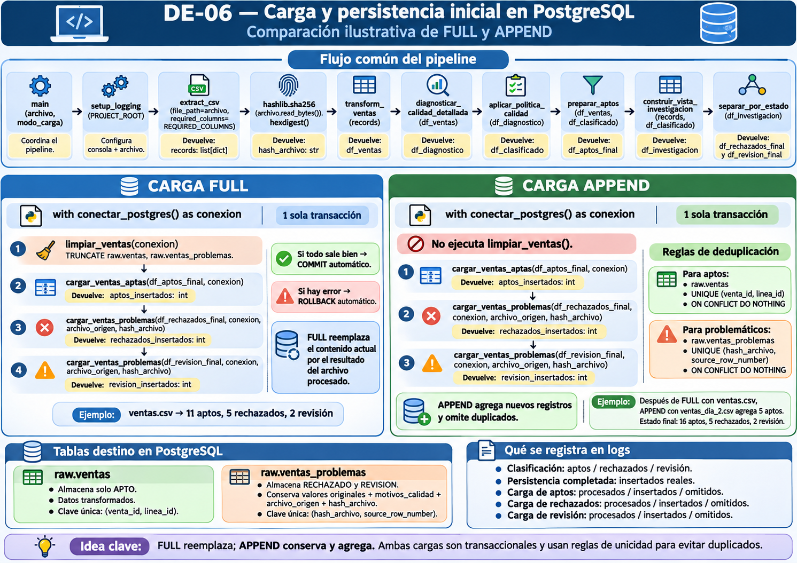

# DE-06 — Persistencia PostgreSQL, calidad, transacciones e idempotencia

**Guía para alumnos · versión 2.0 · FULL y APPEND implementadas y verificadas; INCREMENTAL pendiente**

> Esta versión conserva las pruebas de FULL de la guía 1.1 e incorpora los cambios reales de APPEND. INCREMENTAL, watermarks, control formal de lotes y reconciliación de correcciones **continúan pendientes**. Los ejemplos de fallo intencional se realizan solamente en el laboratorio.

## 1. Objetivos de aprendizaje

Al finalizar esta unidad el estudiante podrá:

- Identificar qué parte de un pipeline corresponde a extracción, calidad y persistencia.
- Crear tablas PostgreSQL adecuadas para datos aceptados y para registros problemáticos con evidencia original.
- Conectar Python a PostgreSQL mediante Psycopg 3 y variables de entorno.
- Explicar qué es una conexión, un cursor, una transacción y la diferencia entre `COMMIT` y `ROLLBACK`.
- Diferenciar atomicidad de idempotencia y carga full de append e incremental.
- Construir una carga FULL transaccional usando **una sola conexión** para limpiar y cargar ambas tablas.
- Construir APPEND con claves de unicidad diferenciadas y protección frente a reprocesamiento por SHA-256.
- Explicar los parámetros, resultados y ubicación exacta de cada función de carga.
- Registrar errores de base de datos con `logger.exception()` y propagarlos con `raise`.
- Verificar resultados con SQL y reproducir de forma segura una prueba de rollback.

## 2. Punto de partida: ¿por qué persistir?

Al terminar DE-05, el pipeline de `data/incoming/ventas.csv` genera tres salidas en memoria:

| Resultado | Registros | Destino en DE-06 |
|---|---:|---|
| `APTO` | 11 | `raw.ventas` |
| `RECHAZADO` | 5 | `raw.ventas_problemas` |
| `REVISION` | 2 | `raw.ventas_problemas` |

```text
ventas.csv
   ↓
extract_csv() y contrato estructural
   ↓
transform_ventas() → diagnóstico → política de calidad
   ↓
   ├── df_aptos_final ───────────────────→ raw.ventas
   ├── df_rechazados_final ──┐
   └── df_revision_final ────┴────────────→ raw.ventas_problemas
                                PostgreSQL: una conexión y una transacción
```

**Precisión de arquitectura:** aunque el esquema se llama `raw`, `raw.ventas` recibe registros **APTOS ya transformados**. No es una copia fiel de todos los bytes de origen. Los problemáticos conservan los valores originales en texto. Es una decisión pedagógica provisional que deberá revisarse al evolucionar el diseño del warehouse.

## 3. Infraestructura y estructura relevante

El laboratorio utiliza PostgreSQL `16-bookworm` en Docker, con base `warehouse`, esquema `raw` y volumen persistente. SQL Server y pgAdmin también están disponibles mediante Docker Compose.

- Python desde Windows: `localhost:5433` → PostgreSQL en Docker `5432`.
- pgAdmin ejecutado en Docker: servicio `postgres-warehouse`, puerto `5432`.
- La instancia de PostgreSQL instalada separadamente en Windows **no es** el destino de este laboratorio.
- pgAdmin se comprobó en `localhost:8080` durante el trabajo; el `compose.yaml` compartido muestra `5050:80`. Verificar el mapeo efectivo con `docker compose ps` y resolver esa discrepancia en el repositorio antes de enseñar la instalación desde cero.
- Schemas de la base: `raw`, `stage`, `warehouse`, `marts` y `public`.

```text
data-engineering-lab/
├── .env                            # secreto local; no versionar
├── compose.yaml
├── requirements.txt
├── postgres/init/
│   ├── 01-create-schemas.sql
│   ├── 02-create-raw-ventas.sql
│   └── 03-create-raw-ventas-problemas.sql
├── data/incoming/ventas.csv
├── data/incoming/ventas_dia_2.csv
├── src/
│   ├── main.py
│   ├── config/logging_config.py
│   ├── extract/csv_extractor.py
│   ├── transform/ventas_transformer.py
│   ├── quality/ventas_quality.py
│   ├── quality/ventas_policy.py
│   └── load/
│       ├── __init__.py
│       └── postgres_loader.py
└── docs/guides/DE06_postgresql_guia.md
```

En el Compose examinado no existe montaje de `postgres/init/` hacia `/docker-entrypoint-initdb.d`. Los scripts SQL se ejecutaron manualmente en pgAdmin. **Guardar scripts en esa carpeta no los ejecuta por sí solo.**

## 4. Contratos de destino: SQL (versión actual)

**Ubicación exacta:** `postgres/init/02-create-raw-ventas.sql`. Copiar el siguiente bloque como contenido completo del script para una **instalación nueva**. En la base existente la restricción se agregó con `ALTER TABLE`; `CREATE TABLE IF NOT EXISTS` no modifica tablas existentes.

### 4.1 `raw.ventas`: datos aptos

```sql
CREATE TABLE IF NOT EXISTS raw.ventas (
    source_row_number BIGINT NOT NULL,
    estado_calidad TEXT NOT NULL,
    venta_id TEXT NOT NULL,
    linea_id TEXT NOT NULL,
    fecha DATE NOT NULL,
    cliente_id TEXT,
    producto_id TEXT,
    sucursal_id TEXT,
    cantidad INTEGER NOT NULL,
    precio_unitario NUMERIC(12,2) NOT NULL,
    descuento_pct INTEGER NOT NULL,

    CONSTRAINT uq_raw_ventas_clave
        UNIQUE (venta_id, linea_id)
);
```

`venta_id` y `linea_id` son códigos, por eso se almacenan como `TEXT`. `UNIQUE (venta_id, linea_id)` evita duplicar una línea de venta entre registros aptos: `venta_id` puede repetirse con otra `linea_id`. `DATE` exige fecha válida y `NUMERIC(12,2)` es el contrato de precio. En este laboratorio la conversión actual de precio usa `float`; para dinero en producción convendría evaluar `Decimal`.

**Ubicación:** pgAdmin, base `warehouse`, Query Tool, **solo sobre una tabla que exista sin esta restricción** (fue ejecutado en el laboratorio):

```sql
ALTER TABLE raw.ventas
ADD CONSTRAINT uq_raw_ventas_clave
UNIQUE (venta_id, linea_id);
```

### 4.2 `raw.ventas_problemas`: evidencia e identidad de observación

**Ubicación exacta:** `postgres/init/03-create-raw-ventas-problemas.sql`. Contenido completo del script para una instalación nueva:

```sql
CREATE TABLE IF NOT EXISTS raw.ventas_problemas (
    source_row_number BIGINT NOT NULL,
    motivos_calidad TEXT[] NOT NULL,
    tiene_problemas BOOLEAN NOT NULL,
    estado_calidad TEXT NOT NULL,
    venta_id TEXT,
    linea_id TEXT,
    fecha TEXT,
    cliente_id TEXT,
    producto_id TEXT,
    sucursal_id TEXT,
    cantidad TEXT,
    precio_unitario TEXT,
    descuento_pct TEXT,
    archivo_origen TEXT,
    hash_archivo CHAR(64) NOT NULL,

    CONSTRAINT chk_estado_ventas_problemas
        CHECK (estado_calidad IN ('RECHAZADO', 'REVISION')),

    CONSTRAINT uq_ventas_problemas_archivo_fila
        UNIQUE (hash_archivo, source_row_number)
);
```

Aquí `fecha`, `cantidad` y `precio_unitario` son `TEXT` para conservar valores originales inválidos. `motivos_calidad` almacena una lista de motivos como `TEXT[]`. **No** se utiliza `(venta_id, linea_id)` como clave única en esta tabla: las filas originales 16 y 17 de la venta 1015 deben conservarse ambas. La identidad usada para evitar reprocesamiento es `(hash_archivo, source_row_number)`.

**Evolución aplicada a la base ya existente**, en este orden: primero se agregó `archivo_origen TEXT`; los siete registros históricos se actualizaron a `ventas.csv`; luego se agregó `hash_archivo CHAR(64)` (inicialmente nullable); se completó el hash original y se comprobaron nulos y duplicados antes de activar restricciones. No ejecutar nuevamente esos `ALTER TABLE` si la base ya tiene las columnas.

```sql
-- Paso histórico 1 (solo cuando NO existe la columna)
ALTER TABLE raw.ventas_problemas
ADD COLUMN archivo_origen TEXT;

-- Paso histórico 2: completar el origen conocido
UPDATE raw.ventas_problemas
SET archivo_origen = 'ventas.csv'
WHERE archivo_origen IS NULL;

-- Paso histórico 3 (solo cuando NO existe la columna)
ALTER TABLE raw.ventas_problemas
ADD COLUMN hash_archivo CHAR(64);

-- Paso histórico 4: completar la identidad si el CSV NO cambió desde su carga
UPDATE raw.ventas_problemas
SET hash_archivo = '5b4c753290accf7c8326f9e0e4b10e9e59db4faf1923a7c5b7af8c6b7a327c28'
WHERE archivo_origen = 'ventas.csv'
  AND hash_archivo IS NULL;
```

El SHA-256 anterior se **obtuvo en el laboratorio**, no es un valor universal. Si el archivo cambió tras la carga inicial, **no se debe asignar** a registros históricos sin evidencia del contenido original. Antes de imponer `NOT NULL` y `UNIQUE` se verificó:

```sql
SELECT COUNT(*) AS registros_sin_hash
FROM raw.ventas_problemas
WHERE hash_archivo IS NULL;

SELECT hash_archivo, source_row_number, COUNT(*) AS repeticiones
FROM raw.ventas_problemas
GROUP BY hash_archivo, source_row_number
HAVING COUNT(*) > 1;
```

Después de obtener **cero nulos y cero duplicados**, en la base existente se ejecutaron:

```sql
ALTER TABLE raw.ventas_problemas
ALTER COLUMN hash_archivo SET NOT NULL;

ALTER TABLE raw.ventas_problemas
ADD CONSTRAINT uq_ventas_problemas_archivo_fila
UNIQUE (hash_archivo, source_row_number);
```

**Precisión:** las restricciones de una tabla creada desde cero y las modificaciones a una tabla ya creada son procedimientos alternativos, no una secuencia para ejecutar ambos sin revisar el estado. Guardar scripts en `postgres/init/` tampoco los ejecuta automáticamente en el Docker Compose revisado: en nuestro laboratorio se ejecutaron por pgAdmin.

## 5. Dependencias y conexión

Versiones observadas durante la unidad:

```text
pandas==3.0.6
psycopg[binary]==3.3.6
python-dotenv==1.2.4
```

Instalar en el entorno virtual:

```powershell
python -m pip install -r requirements.txt
```

En `src/load/postgres_loader.py`:

```python
import os
from pathlib import Path

import psycopg
from dotenv import load_dotenv

PROJECT_ROOT = Path(__file__).resolve().parent.parent.parent
load_dotenv(PROJECT_ROOT / ".env")


def conectar_postgres():
    """Establece una conexión con PostgreSQL."""
    dbname = os.getenv("POSTGRES_DATABASE")
    user = os.getenv("POSTGRES_USER")
    password = os.getenv("POSTGRES_PASSWORD")

    if not all([dbname, user, password]):
        raise ValueError("Faltan variables de configuración para PostgreSQL.")

    conexion = psycopg.connect(
        host="localhost",
        port=5433,
        dbname=dbname,
        user=user,
        password=password,
    )
    return conexion
```

`__file__` identifica el archivo del módulo; `.parent.parent.parent` sube desde `src/load/` a la raíz del proyecto. `load_dotenv()` lee el archivo de variables, `os.getenv()` consulta sus nombres y `psycopg.connect()` crea la conexión. Los valores de host/puerto están fijados para Python ejecutado en Windows en este laboratorio.

Un cursor ejecuta SQL, `fetchone()` obtiene una fila (por ejemplo `(1,)` con `SELECT 1`) y `with conexion.cursor()` cierra el cursor al salir. **El cursor no es dueño de la transacción global.**

## 6. Loaders definitivos con conexión compartida

**Archivo:** `src/load/postgres_loader.py`. **Ubicación exacta:** mantener los imports y `conectar_postgres()` de la sección 5; colocar estas funciones **debajo** de `conectar_postgres()` en el mismo archivo. Es código de la implementación FULL + APPEND verificada.

```python
def limpiar_ventas(conexion):
    """Vacía ambas tablas al iniciar una carga FULL."""
    with conexion.cursor() as cursor:
        cursor.execute("TRUNCATE TABLE raw.ventas, raw.ventas_problemas")


def cargar_ventas_aptas(df_aptos, conexion):
    """Inserta ventas aptas que no existan por clave de negocio."""
    sql = """
        INSERT INTO raw.ventas (
            source_row_number,
            estado_calidad,
            venta_id,
            linea_id,
            fecha,
            cliente_id,
            producto_id,
            sucursal_id,
            cantidad,
            precio_unitario,
            descuento_pct
        )
        VALUES (%s, %s, %s, %s, %s, %s, %s, %s, %s, %s, %s)
        ON CONFLICT (venta_id, linea_id)
        DO NOTHING
    """
    registros_insertados = 0
    with conexion.cursor() as cursor:
        for fila in df_aptos.itertuples(index=False):
            valores = (
                int(fila.source_row_number),
                fila.estado_calidad,
                fila.venta_id,
                fila.linea_id,
                fila.fecha.date(),
                fila.cliente_id,
                fila.producto_id,
                fila.sucursal_id,
                int(fila.cantidad),
                float(fila.precio_unitario),
                int(fila.descuento_pct),
            )
            cursor.execute(sql, valores)
            registros_insertados += cursor.rowcount
    return registros_insertados


def cargar_ventas_problemas(
    df_problemas,
    conexion,
    archivo_origen,
    hash_archivo,
):
    """Inserta rechazados/revisión con valores originales y trazabilidad."""
    sql = """
        INSERT INTO raw.ventas_problemas (
            source_row_number,
            motivos_calidad,
            tiene_problemas,
            estado_calidad,
            venta_id,
            linea_id,
            fecha,
            cliente_id,
            producto_id,
            sucursal_id,
            cantidad,
            precio_unitario,
            descuento_pct,
            archivo_origen,
            hash_archivo
        )
        VALUES (
            %s, %s, %s, %s, %s,
            %s, %s, %s, %s, %s,
            %s, %s, %s, %s, %s
        )
        ON CONFLICT (hash_archivo, source_row_number)
        DO NOTHING
    """
    registros_insertados = 0
    with conexion.cursor() as cursor:
        for fila in df_problemas.itertuples(index=False):
            valores = (
                int(fila.source_row_number),
                fila.motivos_calidad,
                bool(fila.tiene_problemas),
                fila.estado_calidad,
                fila.venta_id,
                fila.linea_id,
                fila.fecha,
                fila.cliente_id,
                fila.producto_id,
                fila.sucursal_id,
                fila.cantidad,
                fila.precio_unitario,
                fila.descuento_pct,
                archivo_origen,
                hash_archivo,
            )
            cursor.execute(sql, valores)
            registros_insertados += cursor.rowcount
    return registros_insertados
```

**Qué recibe y devuelve cada función:**

| Función | Parámetros | Retorno | Responsabilidad |
|---|---|---|---|
| `conectar_postgres` | Ninguno | Conexión Psycopg | Abrir PostgreSQL con `.env` |
| `limpiar_ventas` | `conexion` | `None` implícito | Vaciar ambos destinos solo en FULL |
| `cargar_ventas_aptas` | `df_aptos`, `conexion` | `int` | Insertados reales de aptos |
| `cargar_ventas_problemas` | `df_problemas`, `conexion`, `archivo_origen`, `hash_archivo` | `int` | Insertados reales de problemas |

`itertuples(index=False)` itera registros sin el índice de Pandas. Cada `%s` es un marcador seguro de Psycopg: la lista de columnas, marcadores y valores debe tener la misma longitud (11 o 15). `ON CONFLICT DO NOTHING` no reemplaza registros existentes. `cursor.rowcount` suma **1 si se insertó y 0 si se omitió**. Ninguna función del loader hace `commit()`, `rollback()` ni `close()`: `main.py` gestiona toda la transacción. La adaptación de `motivos_calidad` desde lista Python a `TEXT[]` fue verificada previamente. Para grandes volúmenes se evaluarán técnicas por lotes o `COPY` cuando haga falta.

## 7. Carga full transaccional e idempotencia

### 7.1 Problema: los `INSERT` se acumulan

En el diseño **inicial**, sin limpieza ni reglas de unicidad, una segunda ejecución insertaba otros 18 registros. Este fue el problema que motivó implementar FULL y, posteriormente, APPEND. La versión actual sí incorpora restricciones `UNIQUE`.

- **Full/reemplazo:** vuelve a cargar todo el conjunto de datos.
- **Append:** agrega registros al destino; no implica detectar novedades por sí mismo.
- **Incremental:** selecciona solo los registros nuevos o modificados por algún criterio; puede utilizar `INSERT`, `UPDATE` o `UPSERT`.
- **Idempotencia:** repetir la misma operación con iguales entradas deja el mismo estado lógico final.
- **Atomicidad:** o se confirman todas las operaciones de una transacción o se revierten todas.

FULL transaccional fue la primera solución didáctica; posteriormente se añadió APPEND idempotente. No confundir idempotencia con incrementalidad.

### 7.2 Añadir limpieza en el loader

```python
def limpiar_ventas(conexion):
    """Vacía las tablas de ventas antes de una carga full."""
    with conexion.cursor() as cursor:
        cursor.execute("TRUNCATE TABLE raw.ventas, raw.ventas_problemas")
```

Esta función no abre ni confirma una transacción por su cuenta.

### 7.3 Integrar la carga desde `main.py`

**Archivo exacto:** `src/main.py`. **Ubicación:** dentro de `main()`, en el bloque `try` y después de producir `df_aptos_final`, `df_rechazados_final` y `df_revision_final` (ver código integral de la sección 15). Reemplazar el bloque antiguo de persistencia simple por:

```python
# Persistencia de las tres salidas en una sola transacción
with conectar_postgres() as conexion:
    if modo_carga == "full":
        limpiar_ventas(conexion)

    aptos_insertados = cargar_ventas_aptas(df_aptos_final, conexion)

    rechazados_insertados = cargar_ventas_problemas(
        df_rechazados_final,
        conexion,
        archivo_origen=archivo.name,
        hash_archivo=hash_archivo,
    )
    revision_insertados = cargar_ventas_problemas(
        df_revision_final,
        conexion,
        archivo_origen=archivo.name,
        hash_archivo=hash_archivo,
    )
```

Solo FULL llama a `limpiar_ventas`. En APPEND los registros que ya existen son omitidos. Psycopg confirma `COMMIT` al salir normalmente del `with`; si una excepción sale de ese bloque, revierte la transacción. **Los logs de éxito van después del `with`**. El comportamiento `FULL` reemplaza todas las filas de ambas tablas, por lo que se utiliza solo cuando el CSV representa el conjunto completo que debe permanecer.

## 8. Ejecutar FULL y APPEND y comprobar resultados

**Lugar:** terminal PowerShell en la raíz de `data-engineering-lab`, con `.venv` activado. En la versión actual `python -m src.main` ejecuta `main()` con valores por defecto: `archivo=VENTAS_FILE`, `modo_carga="full"`. **Precaución:** esto ejecuta `TRUNCATE` y no debe hacerse accidentalmente en una base compartida.

```powershell
# FULL del archivo por defecto, solo en este laboratorio
python -m src.main

# FULL explícito
python -c "from pathlib import Path; from src.main import main; main(archivo=Path('data/incoming/ventas.csv'), modo_carga='full')"

# APPEND con el segundo archivo
python -c "from pathlib import Path; from src.main import main; main(archivo=Path('data/incoming/ventas_dia_2.csv'), modo_carga='append')"
```

**Archivo:** `data/incoming/ventas_dia_2.csv`. Contenido completo utilizado en la práctica:

```csv
venta_id,linea_id,fecha,cliente_id,producto_id,sucursal_id,cantidad,precio_unitario,descuento_pct
2001,1,2026-09-08,1,101,1,2,450.00,0
2002,1,2026-09-08,2,102,2,1,1200.00,5
2003,1,2026-09-08,3,103,1,3,300.00,10
2004,1,2026-09-08,4,104,2,1,850.00,0
2005,1,2026-09-08,5,105,1,2,600.00,5
```

**Consulta en pgAdmin / `warehouse`**, después de cada ejecución:

```sql
SELECT 'APTO' AS estado, COUNT(*) AS total
FROM raw.ventas
UNION ALL
SELECT estado_calidad, COUNT(*) AS total
FROM raw.ventas_problemas
GROUP BY estado_calidad;
```

| Secuencia | APTO | RECHAZADO | REVISION | Total |
|---|---:|---:|---:|---:|
| FULL `ventas.csv` | 11 | 5 | 2 | 18 |
| Después: APPEND `ventas_dia_2.csv` | 16 | 5 | 2 | 23 |
| Repetir APPEND del mismo archivo | 16 | 5 | 2 | 23 |
| Repetir APPEND de `ventas.csv` sobre esos 23 | 16 | 5 | 2 | 23 |
| Volver a ejecutar FULL `ventas.csv` | 11 | 5 | 2 | 18 |
| Restaurar con APPEND `ventas_dia_2.csv` | 16 | 5 | 2 | 23 |

La secuencia se realizó y se comprobó con logs y consultas SQL. La tabla `raw.ventas` almacena 16 ventas aptas; `raw.ventas_problemas` almacena las 7 originales tras retirar las pruebas temporales.

## 9. Transacciones, bloqueos y pruebas de rollback

### 9.1 `BEGIN`, Auto-commit, `COMMIT` y `ROLLBACK`

- Fuera de una transacción explícita, un cliente SQL con Auto-commit activado confirma cada operación exitosa.
- `BEGIN` inicia una transacción explícita que se cierra con `COMMIT` o `ROLLBACK`.
- PostgreSQL permite revertir `TRUNCATE` dentro de una transacción.
- `TRUNCATE` adquiere un bloqueo `ACCESS EXCLUSIVE`: otra sesión que intente leer la tabla puede quedarse esperando hasta que se confirme o revierta la transacción.

**Observación real:** al ejecutar `BEGIN; TRUNCATE ...;` desde pgAdmin, una consulta en otra sesión quedó esperando. Al finalizar la transacción se liberó el bloqueo. Esto no prueba por sí solo el estado del interruptor Auto-commit del cliente.

### 9.2 Prueba controlada: revertir solo el vaciado

En **una misma sesión** de Query Tool, sobre las tablas de laboratorio:

```sql
BEGIN;
TRUNCATE TABLE raw.ventas, raw.ventas_problemas;
SELECT COUNT(*) FROM raw.ventas;           -- 0 dentro de la transacción
SELECT COUNT(*) FROM raw.ventas_problemas; -- 0 dentro de la transacción
ROLLBACK;
```

La verificación posterior devolvió nuevamente 11 aptos y 7 problemáticos.

### 9.3 Prueba controlada: error después de insertar

Solo en este laboratorio, en una sesión dedicada:

```sql
BEGIN;
TRUNCATE TABLE raw.ventas, raw.ventas_problemas;

INSERT INTO raw.ventas (
    source_row_number, estado_calidad, venta_id, linea_id,
    fecha, cantidad, precio_unitario, descuento_pct
) VALUES (999, 'APTO', 'PRUEBA', '1', '2026-09-01', 1, 100, 0);

-- Fallo intencional: cantidad es NOT NULL
INSERT INTO raw.ventas (
    source_row_number, estado_calidad, venta_id, linea_id,
    fecha, cantidad, precio_unitario, descuento_pct
) VALUES (1000, 'APTO', 'PRUEBA_ERROR', '1', '2026-09-01', NULL, 100, 0);
```

La segunda inserción produjo un error de restricción `NOT NULL`. En la **misma conexión** se ejecutó `ROLLBACK;` y se verificó que los 18 registros anteriores seguían presentes y que `venta_id='PRUEBA'` no permaneció almacenado.

**Alcance de la evidencia:** esta prueba demuestra la atomicidad de PostgreSQL; no es una simulación de fallo insertando mediante `src.main` y su `except` integrado.

## 10. Pruebas del logger y propagación de errores

Se comprobó en una llamada independiente que una conexión con usuario y contraseña intencionalmente erróneos provocaba `psycopg.OperationalError` (autenticación rechazada). La conexión real del laboratorio no se modificó.

También se creó temporalmente `prueba_logger.py` para estudiar `logger.exception()` y `raise`:

```python
import logging
from pathlib import Path
import psycopg
from src.config.logging_config import setup_logging

setup_logging(Path(__file__).resolve().parent)
logger = logging.getLogger(__name__)

try:
    raise psycopg.OperationalError("Fallo simulado de conexión")
except psycopg.Error:
    logger.exception("Error durante la conexión o persistencia en PostgreSQL.")
    raise
```

El mensaje de error y traceback aparecieron en consola y en `logs/pipeline.log`. Que la traza aparezca dos veces en consola es coherente: una la imprime `logger.exception()` y otra el intérprete al propagarse la excepción no capturada. Las pruebas temporales `prueba_logger.py` y `prueba_rollback.py` fueron destinadas a eliminarse después de su uso, no forman parte del pipeline.

## 11. Errores, decisiones y límites

| Situación | Aprendizaje |
|---|---|
| `psycopg.OperationalError` | Problema de conexión/autenticación; registrar la excepción sin mostrar secretos. |
| Error por columna `NOT NULL` | PostgreSQL protege el contrato; fuera del `with` se habrá efectuado rollback. |
| Otra sesión bloqueada durante TRUNCATE | `TRUNCATE` mantiene bloqueo fuerte hasta terminar la transacción. |
| `TypeError: ... missing ... archivo_origen` | Los argumentos se agregaron por error a `cargar_ventas_aptas`; se corrigió la firma y el INSERT, y se aplicó la trazabilidad únicamente a problemáticos. |
| Cantidad de `%s` incorrecta | Debe coincidir con el número de columnas y valores: 11 para aptos y 15 para problemáticos. |
| Encabezado del CSV con línea en blanco | La extracción identificó columnas faltantes; se quitó la línea vacía inicial del segundo archivo. |
| Reprocesamiento APPEND | Se omite la misma clave apta y la misma observación problemática sin error. |
| `CREATE TABLE IF NOT EXISTS` | No agrega restricciones a una tabla existente; se utilizaron `ALTER TABLE` y actualizaciones controladas. |

**Límites declarados:**

- `raw.ventas` omite una venta con igual `(venta_id, linea_id)` aunque el precio u otro dato haya sido corregido. En INCREMENTAL necesitaremos una política explícita de actualización/revisión; `DO NOTHING` no significa que el contenido sea igual.
- El hash SHA-256 identifica **bytes del archivo completo**, no una venta. Si cambia un solo byte, toda la versión recibe otro hash; observaciones problemáticas sin cambios también podrían conservarse otra vez bajo una versión nueva. Esto es una decisión de trazabilidad por versión.
- Archivo y hash se calculan en **lecturas separadas** (`extract_csv` y `archivo.read_bytes()`). Para producción deberá evitarse que el archivo cambie entre ambas lecturas (p. ej., entregas atómicas o snapshot estable).
- El nombre alternativo de un archivo renombrado pero idéntico **no se registra** en una nueva fila cuando el `ON CONFLICT` omite el registro. El hash sí permite reconocer el reprocesamiento.
- No hay tabla de control de lotes, watermark, reconciliación de correcciones ni interfaz CLI con argumentos `--modo` o `--archivo` todavía.
- FULL trunca ambas tablas enteras y toma bloqueos fuertes. Solo es adecuado para estos destinos dedicados del laboratorio. No introducir `TRUNCATE CASCADE` indiscriminadamente.
- El esquema `raw` para aptos contiene datos transformados; es una decisión provisional del laboratorio.

## 12. Git y documentación (antecedentes de FULL)

Flujo Git vigente para el laboratorio: rama local → cambios y verificación → `git status` → commit → merge local a `main` → `push origin main` → eliminar rama. FULL ya estaba integrado en `main` según el seguimiento posterior. La rama APPEND confirmada es `feature/de06-append`; su cierre Git aún está pendiente.

Comprobaciones seguras antes de registrar los archivos:

```powershell
git status
git branch --show-current
git ls-files -- .env
```

Revisar especialmente `src/main.py`, `src/load/postgres_loader.py`, los scripts `postgres/init/`, esta guía y `PROJECT_STATE.md`. El archivo `.env` y logs operativos no deben subirse.

## 13. Actividad de comprobación para los alumnos

El estudiante debería poder explicar:

1. ¿Por qué los problemáticos se almacenan con `fecha`, `cantidad` y `precio_unitario` como texto?
2. ¿Por qué las funciones del loader reciben la conexión y no ejecutan `COMMIT`?
3. ¿Qué problema evita que `limpiar_ventas()` esté **dentro** de la misma transacción que las inserciones?
4. ¿Qué diferencia hay entre atomicidad e idempotencia?
5. ¿Por qué dos ejecuciones con el mismo CSV terminan en 18 registros y no en 36?
6. ¿Por qué una consulta puede bloquearse al intentar leer tablas truncadas desde otra conexión?
7. ¿Qué añade `logger.exception()` a `logger.error()` y para qué sirve `raise`?
8. ¿Cuándo usaríamos append o incremental en vez de full?
9. ¿Por qué cambia el hash cuando se modifica solo una fila?
10. ¿Por qué una venta con clave ya existente pero precio corregido no se actualiza con `DO NOTHING`?

## 14. APPEND — problema, diseño y evolución incremental de la solución

### 14.1 ¿Qué resuelve APPEND?

FULL reemplaza todos los registros de ambas tablas. Si llega otro CSV con cinco ventas nuevas, no queremos eliminar las 18 observaciones ya cargadas. APPEND **no ejecuta `limpiar_ventas()`** y utiliza restricciones de unicidad para incorporar solo filas nuevas según cada regla.

### 14.2 Identidades diferentes según destino

| Destino | Clave `UNIQUE` | Por qué |
|---|---|---|
| `raw.ventas` | `(venta_id, linea_id)` | Una sola línea de venta apta por clave de negocio |
| `raw.ventas_problemas` | `(hash_archivo, source_row_number)` | Varias observaciones pueden compartir la clave de negocio; conservar evidencia sin duplicar una misma fila de una versión |

La venta `1015`, línea `1`, aparece dos veces en las posiciones 16 y 17 del CSV. Ambas fueron clasificadas `REVISION`, se conservaron en problemas y **no** fueron insertadas como aptas. La restricción de aptos protege la unicidad de negocio; la de problemas protege la identidad de observación.

### 14.3 Introducir `modo_carga` y elegir el archivo

**Archivo:** `src/main.py`. **Ubicación:** firma de `main` (reemplazar la firma anterior); la validación va al comienzo del `try`, **antes** de extraer:

```python
def main(archivo: Path = VENTAS_FILE, modo_carga: str = "full") -> None:
    setup_logging(PROJECT_ROOT)
    logger.info("Inicio del pipeline.")
    try:
        if modo_carga not in ("full", "append"):
            raise ValueError(
                f"Modo de carga no válido: {modo_carga}. "
                "Los valores permitidos son 'full' y 'append'."
            )
        records = extract_csv(
            file_path=archivo,
            required_columns=REQUIRED_COLUMNS,
        )
        # A partir de aquí continúa la transformación existente.
```

`main()` recibe la ruta y el modo. La llamada por defecto sigue siendo FULL; con `modo_carga="append"` se conserva lo ya almacenado. El uso de `Path` ayuda a obtener `archivo.name` y a leer sus bytes para el hash.

### 14.4 Calcular SHA-256

**Archivo:** `src/main.py`. **Ubicación exacta:** `import hashlib` al principio con los imports estándar. Dentro de `main()`, justo **después de `extract_csv(...)`** y antes de `if records:`:

```python
hash_archivo = hashlib.sha256(
    archivo.read_bytes()
).hexdigest()

logger.info("SHA-256 del archivo: %s", hash_archivo)
logger.info("Extracción finalizada correctamente.")
```

`read_bytes()` lee bytes; `hashlib.sha256(...)` produce un digest de 256 bits y `hexdigest()` lo representa como 64 caracteres hexadecimales. Mismo contenido exacto → mismo hash, aunque cambie el nombre. Mismo nombre y contenido diferente → nuevo hash. También cambia si cambian los saltos de línea o la codificación. En archivos grandes leeríamos por bloques.

Práctica desde la raíz del repositorio:

```powershell
python -c "import hashlib; from pathlib import Path; archivo = Path('data/incoming/ventas.csv'); print(hashlib.sha256(archivo.read_bytes()).hexdigest())"
```

En la práctica el resultado fue:

```text
5b4c753290accf7c8326f9e0e4b10e9e59db4faf1923a7c5b7af8c6b7a327c28
```

La huella histórica solo es válida para los bytes originales de aquel archivo.

### 14.5 Conectar el hash al loader

**Archivo:** `src/load/postgres_loader.py`. Reemplazar la firma de `cargar_ventas_problemas` para recibir `archivo_origen` y `hash_archivo`, añadir esas dos columnas al `INSERT`, sumar sus `%s` y valores, y añadir `ON CONFLICT (hash_archivo, source_row_number) DO NOTHING`. **El código completo y definitivo está en la sección 6**; no modificar `cargar_ventas_aptas` para este cambio.

**Archivo:** `src/main.py`. Dentro del `with conectar_postgres() as conexion:`, llamar al loader dos veces con argumentos nombrados:

```python
rechazados_insertados = cargar_ventas_problemas(
    df_rechazados_final,
    conexion,
    archivo_origen=archivo.name,
    hash_archivo=hash_archivo,
)
revision_insertados = cargar_ventas_problemas(
    df_revision_final,
    conexion,
    archivo_origen=archivo.name,
    hash_archivo=hash_archivo,
)
```

`archivo_origen=archivo.name` usa un argumento con nombre: a la izquierda está el parámetro declarado en el loader; a la derecha, la expresión que devuelve el nombre del archivo. Lo mismo ocurre con `hash_archivo=hash_archivo`.

### 14.6 Contar insertados y omitidos

**Archivo:** `src/load/postgres_loader.py`. Las dos funciones de carga inicializan `registros_insertados = 0`, suman `cursor.rowcount` tras cada ejecución y devuelven el resultado con `return` (ver sección 6).

**Archivo:** `src/main.py`. **Ubicación exacta:** inmediatamente después del bloque de conexión:

```python
aptos_omitidos = len(df_aptos_final) - aptos_insertados
rechazados_omitidos = len(df_rechazados_final) - rechazados_insertados
revision_omitidos = len(df_revision_final) - revision_insertados

logger.info(
    "Persistencia completada: %s aptos, %s rechazados y %s en revisión insertados.",
    aptos_insertados,
    rechazados_insertados,
    revision_insertados,
)
logger.info(
    "Carga de aptos: %s procesados, %s insertados y %s omitidos por duplicidad.",
    len(df_aptos_final), aptos_insertados, aptos_omitidos,
)
logger.info(
    "Carga de rechazados: %s procesados, %s insertados y %s omitidos por duplicidad.",
    len(df_rechazados_final), rechazados_insertados, rechazados_omitidos,
)
logger.info(
    "Carga de revisión: %s procesados, %s insertados y %s omitidos por duplicidad.",
    len(df_revision_final), revision_insertados, revision_omitidos,
)
```

**Interpretación:** procesados = filas clasificadas en el DataFrame; insertados = `rowcount` real; omitidos = procesados menos insertados. El mensaje `Persistencia completada` informa **insertados**, no solo clasificados.

### 14.7 Pruebas de reenvío y versiones

Para la prueba se creó `data/incoming/ventas_prueba_problemas.csv`:

```csv
venta_id,linea_id,fecha,cliente_id,producto_id,sucursal_id,cantidad,precio_unitario,descuento_pct
3001,1,2026-09-09,1,101,1,-2,450.00,0
```

Se ejecutó por APPEND, se verificó la fila 3001 y se repitió sin modificar el CSV: log `1 procesado, 0 insertados y 1 omitido`. Luego se copió como `ventas_renombrado.csv` sin cambios de contenido: mismo hash, 0 insertados. Por último se cambió `cantidad` de `-2` a `-3` en el CSV copiado: hash diferente, 1 nueva observación insertada. Se retiraron después las dos filas de prueba para conservar los 7 problemáticos del conjunto original.

Comandos empleados:

```powershell
python -c "from pathlib import Path; from src.main import main; main(archivo=Path('data/incoming/ventas_prueba_problemas.csv'), modo_carga='append')"
Copy-Item 'data/incoming/ventas_prueba_problemas.csv' 'data/incoming/ventas_renombrado.csv'
python -c "from pathlib import Path; from src.main import main; main(archivo=Path('data/incoming/ventas_renombrado.csv'), modo_carga='append')"
```

Consultas de comprobación:

```sql
SELECT venta_id, source_row_number, archivo_origen, hash_archivo, cantidad
FROM raw.ventas_problemas
WHERE venta_id = '3001';

-- Limpieza únicamente de las dos observaciones didácticas
DELETE FROM raw.ventas_problemas
WHERE venta_id = '3001'
  AND archivo_origen IN ('ventas_prueba_problemas.csv', 'ventas_renombrado.csv')
RETURNING venta_id, cantidad, archivo_origen;
```

Para validar que no quedan duplicados por identidad de observación:

```sql
SELECT hash_archivo, source_row_number, COUNT(*) AS repeticiones
FROM raw.ventas_problemas
GROUP BY hash_archivo, source_row_number
HAVING COUNT(*) > 1;
```

Resultado esperado: **ninguna fila**. La prueba comprobó también FULL + APPEND y restauró los conteos: 16 aptos, 5 rechazados, 2 en revisión.

## 15. `src/main.py` — código completo del punto de entrada de FULL y APPEND

**Ubicación:** reemplazar/actualizar cuidadosamente el contenido de `src/main.py` **solo si se está reconstruyendo el laboratorio desde cero**, conservando los módulos de extracción, transformación y calidad trabajados en DE-04/DE-05. Este bloque se reconstruyó a partir del `main.py` compartido durante el desarrollo y sus modificaciones verificadas de logging. No es una implementación de los módulos importados.

```python
"""Punto de entrada principal del pipeline."""

import hashlib
import logging
from pathlib import Path

import psycopg

from src.config.logging_config import setup_logging
from src.contracts.ventas_contract import REQUIRED_COLUMNS
from src.extract.csv_extractor import extract_csv
from src.transform.ventas_transformer import transform_ventas
from src.quality.ventas_quality import (
    diagnosticar_calidad_detallada,
    construir_vista_investigacion,
)
from src.quality.ventas_policy import (
    aplicar_politica_calidad,
    separar_por_estado,
    preparar_aptos,
)
from src.load.postgres_loader import (
    conectar_postgres,
    cargar_ventas_aptas,
    cargar_ventas_problemas,
    limpiar_ventas,
)

PROJECT_ROOT = Path(__file__).resolve().parent.parent
VENTAS_FILE = PROJECT_ROOT / "data" / "incoming" / "ventas.csv"
logger = logging.getLogger(__name__)


def main(
    archivo: Path = VENTAS_FILE,
    modo_carga: str = "full",
) -> None:
    """Coordina extracción, calidad y persistencia de ventas."""
    setup_logging(PROJECT_ROOT)
    logger.info("Inicio del pipeline.")

    try:
        if modo_carga not in ("full", "append"):
            raise ValueError(
                f"Modo de carga no válido: {modo_carga}. "
                "Los valores permitidos son 'full' y 'append'."
            )

        # Extracción
        records = extract_csv(
            file_path=archivo,
            required_columns=REQUIRED_COLUMNS,
        )

        # Identidad del contenido
        hash_archivo = hashlib.sha256(
            archivo.read_bytes()
        ).hexdigest()
        logger.info("SHA-256 del archivo: %s", hash_archivo)
        logger.info("Extracción finalizada correctamente.")

        if records:
            df_ventas = transform_ventas(records)
            logger.info("Transformación inicial de ventas finalizada correctamente.")

            df_diagnostico = diagnosticar_calidad_detallada(df_ventas)
            df_clasificado = aplicar_politica_calidad(df_diagnostico)
            df_aptos_final = preparar_aptos(df_ventas, df_clasificado)
            df_investigacion = construir_vista_investigacion(
                records, df_clasificado,
            )
            _, df_rechazados_final, df_revision_final = separar_por_estado(
                df_investigacion
            )

            total_registros = len(df_diagnostico)
            total_con_problemas = int(df_diagnostico["tiene_problemas"].sum())
            total_sin_problemas = total_registros - total_con_problemas
            logger.info(
                "Diagnóstico de calidad: %s registros analizados, "
                "%s con problemas y %s sin problemas detectados.",
                total_registros,
                total_con_problemas,
                total_sin_problemas,
            )

            conteo_estados = df_clasificado["estado_calidad"].value_counts()
            logger.info(
                "Clasificación de calidad: %s aptos, %s rechazados y %s en revisión.",
                int(conteo_estados.get("APTO", 0)),
                int(conteo_estados.get("RECHAZADO", 0)),
                int(conteo_estados.get("REVISION", 0)),
            )
            logger.info(
                "Salidas preparadas: %s aptos transformados, "
                "%s rechazados y %s en revisión con valores originales.",
                len(df_aptos_final),
                len(df_rechazados_final),
                len(df_revision_final),
            )

            # Una conexión: un COMMIT o un ROLLBACK para las tres salidas
            with conectar_postgres() as conexion:
                if modo_carga == "full":
                    limpiar_ventas(conexion)

                aptos_insertados = cargar_ventas_aptas(
                    df_aptos_final, conexion,
                )
                rechazados_insertados = cargar_ventas_problemas(
                    df_rechazados_final,
                    conexion,
                    archivo_origen=archivo.name,
                    hash_archivo=hash_archivo,
                )
                revision_insertados = cargar_ventas_problemas(
                    df_revision_final,
                    conexion,
                    archivo_origen=archivo.name,
                    hash_archivo=hash_archivo,
                )

            aptos_omitidos = len(df_aptos_final) - aptos_insertados
            rechazados_omitidos = len(df_rechazados_final) - rechazados_insertados
            revision_omitidos = len(df_revision_final) - revision_insertados

            logger.info(
                "Persistencia completada: %s aptos, %s rechazados "
                "y %s en revisión insertados.",
                aptos_insertados, rechazados_insertados, revision_insertados,
            )
            logger.info(
                "Carga de aptos: %s procesados, %s insertados "
                "y %s omitidos por duplicidad.",
                len(df_aptos_final), aptos_insertados, aptos_omitidos,
            )
            logger.info(
                "Carga de rechazados: %s procesados, %s insertados "
                "y %s omitidos por duplicidad.",
                len(df_rechazados_final), rechazados_insertados, rechazados_omitidos,
            )
            logger.info(
                "Carga de revisión: %s procesados, %s insertados "
                "y %s omitidos por duplicidad.",
                len(df_revision_final), revision_insertados, revision_omitidos,
            )
        else:
            logger.warning(
                "El archivo fue extraído correctamente, pero no contiene registros."
            )

    except FileNotFoundError as error:
        logger.error("Error de archivo: %s", error)
        raise
    except ValueError as error:
        logger.error("Error durante el procesamiento: %s", error)
        raise
    except psycopg.Error:
        logger.exception("Error durante la conexión o persistencia en PostgreSQL.")
        raise
    finally:
        logger.info("Fin de la ejecución.")


if __name__ == "__main__":
    main()
```

**Diferencia entre definir y ejecutar:** `def main(...)` crea la función. `if __name__ == "__main__": main()` la llama si se usa `python -m src.main`, por defecto en FULL. En desarrollo APPEND se ejecutó mediante `python -c` importando `main` y pasando argumentos; en producción lo habitual es que un programador u orquestador (p. ej., Airflow cuando toque esa unidad) invoque un proceso parametrizado. Una CLI con `--archivo` y `--modo` es una **mejora propuesta, aún no implementada**.

**Límite de la gestión de errores:** `logger.exception` captura específicamente `psycopg.Error`; otros fallos Python también hacen rollback si salen del `with`, aunque pueden mostrarse sin ese mensaje particular. Si `records` está vacío, el diseño actual registra advertencia y no hace FULL: ese caso deberá discutirse como política antes de automatizar reemplazos.

## 16. Tabla-resumen de métodos y salidas

| Método / instrucción | Entrada principal | Resultado o efecto |
|---|---|---|
| `main(archivo, modo_carga)` | Ruta `Path`, modo `str` | Coordina el flujo, retorna `None` |
| `setup_logging(PROJECT_ROOT)` | Raíz del proyecto | Configura logging |
| `extract_csv(...)` | CSV y contrato | `records`: lista de diccionarios |
| `hashlib.sha256(...).hexdigest()` | Bytes del CSV | `hash_archivo`: `str` de 64 caracteres |
| `transform_ventas(records)` | Datos extraídos | `df_ventas` |
| `diagnosticar_calidad_detallada(df_ventas)` | DataFrame transformado | `df_diagnostico` |
| `aplicar_politica_calidad(df_diagnostico)` | Diagnóstico | `df_clasificado` |
| `preparar_aptos(...)` | Ventas + clasificación | `df_aptos_final` |
| `construir_vista_investigacion(...)` | Datos originales + estados | `df_investigacion` |
| `separar_por_estado(df_investigacion)` | Vista de investigación | Tupla: aptos de vista, rechazados, revisión |
| `conectar_postgres()` | Variables `.env` | Conexión Psycopg |
| `limpiar_ventas(conexion)` | Conexión | TRUNCATE, solo FULL |
| `cargar_ventas_aptas(...)` | APTOS y conexión | `int` insertados |
| `cargar_ventas_problemas(...)` | Problemáticos + conexión + identidad | `int` insertados |
| `cursor.rowcount` | Último INSERT de cursor | 1 insertado, 0 omitido (en este caso) |
| Salida de `with conectar_postgres()` | Resultado de las cargas | COMMIT al éxito / ROLLBACK ante excepción |

## 17. Infografía comparativa FULL y APPEND

**Archivo previsto dentro del repositorio:** `img/infografia_postgresql_full_vs_append.png`. La imagen se prepara como recurso didáctico del bloque; antes del commit comprobar su ubicación y que `.gitignore` no excluya `img/`.



**Lectura sugerida:** primero identificar las salidas de extracción/calidad, luego observar que FULL ejecuta `TRUNCATE` y APPEND no, y finalmente comprobar que ambas comparten los mismos loaders, las claves de unicidad y una única transacción.

## 18. Git y cierre de esta unidad

**Rama confirmada por el usuario:** `feature/de06-append`. FULL ya había sido integrado previamente a `main`. En esta rama se modificaron `src/main.py`, `src/load/postgres_loader.py`, `postgres/init/02-create-raw-ventas.sql`, `postgres/init/03-create-raw-ventas-problemas.sql` y el CSV `data/incoming/ventas_dia_2.csv`. El commit, el push, el merge y la eliminación de la rama de APPEND **todavía no están confirmados**.

Se detectaron además cambios personales **ajenos al cierre APPEND** en guías DE-05 y en `pruebas/`, junto con CSV temporales `ventas_prueba_problemas.csv` y `ventas_renombrado.csv`. No agregarlos indiscriminadamente. No agregar `.env`, logs ni credenciales. Revisar `.gitignore`: la carpeta de imágenes que se incluirá en las guías no debe estar ignorada.

```powershell
git branch --show-current
git status
git diff --check
# Revisar archivos concretos antes de ejecutar git add por rutas explícitas.
```

En el siguiente paso práctico del chat: revisar esta guía generada contra el código local, copiar la versión aprobada, añadir solamente archivos DE-06, crear commit y completar el flujo Git acordado. **No hay commits inventados en esta guía.**

## 19. Qué sigue después de APPEND

**INCREMENTAL** permanece pendiente. Habrá que definir qué hacer cuando una venta apta ya existente llegue corregida, cuándo se actualiza, cuál será el watermark o criterio de cambio y cómo garantizar reintentos; después se abordarán control de lotes y orquestación cuando existan esas necesidades. Hasta decidir esas políticas, no extender `ON CONFLICT DO NOTHING` como si resolviera toda actualización de datos.